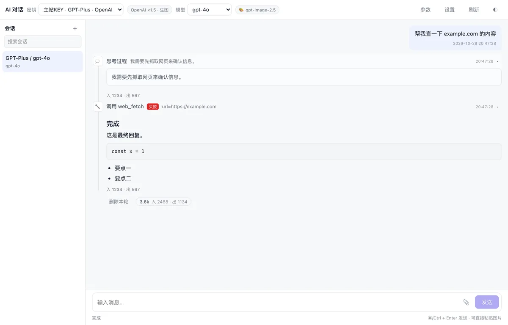
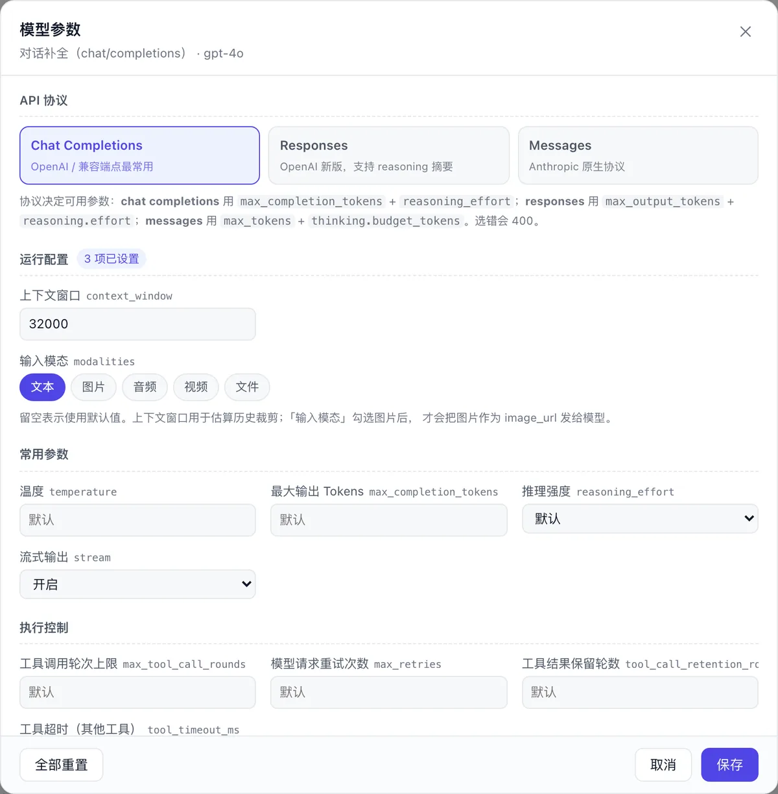
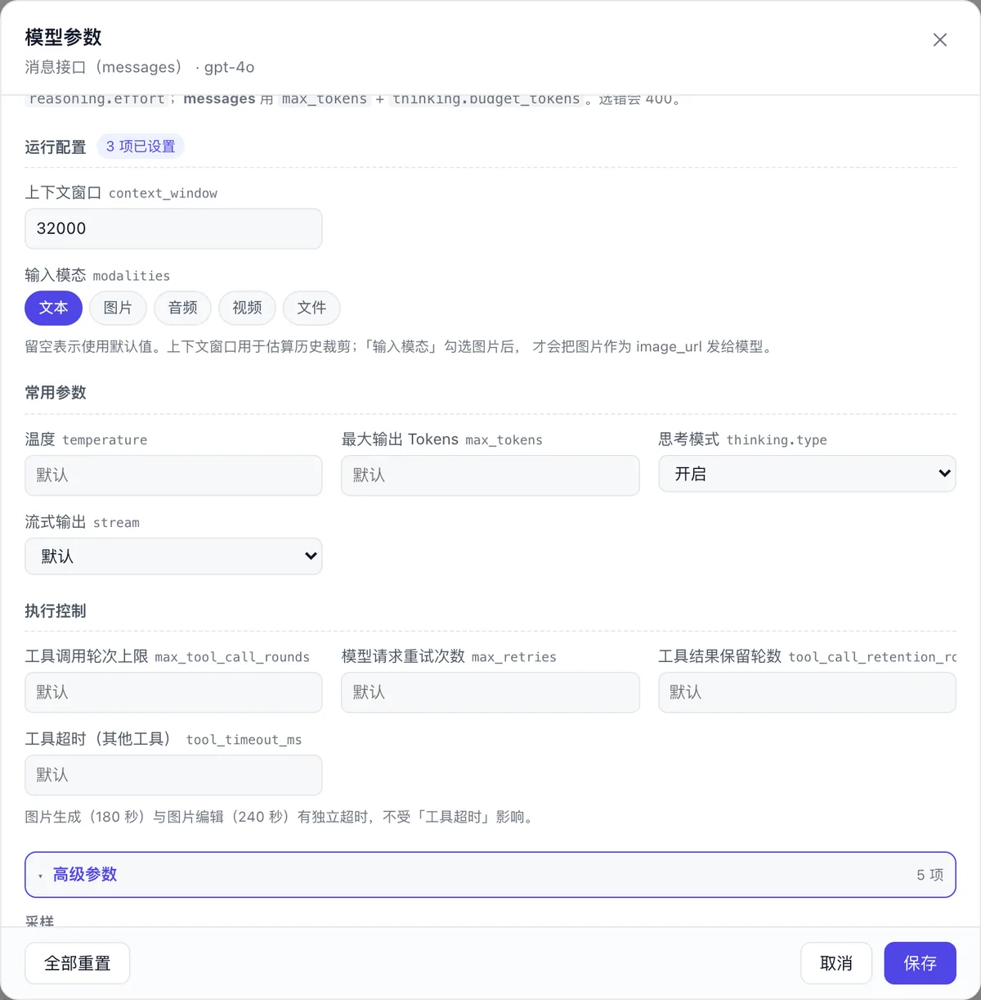
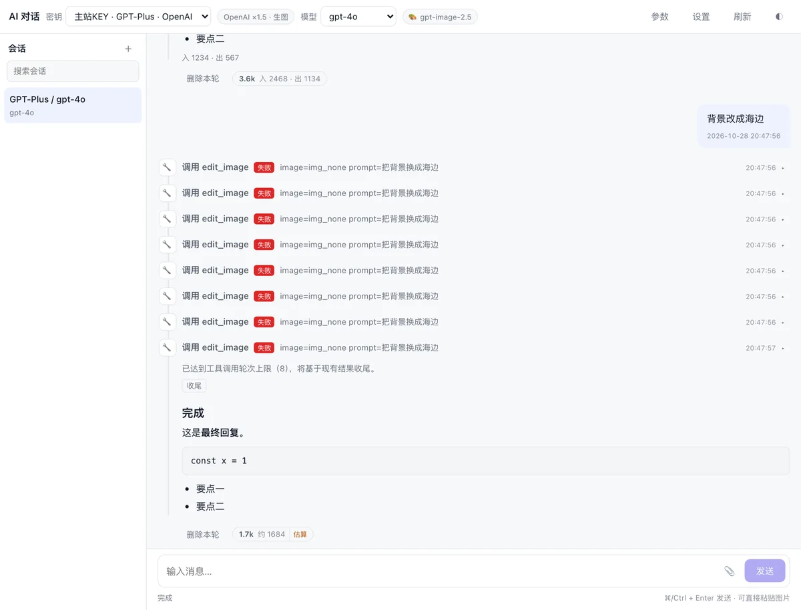
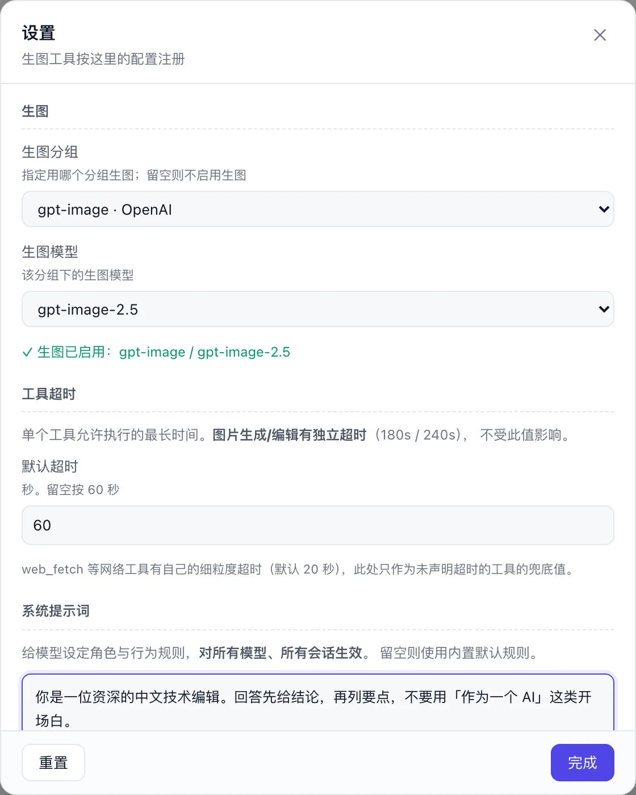
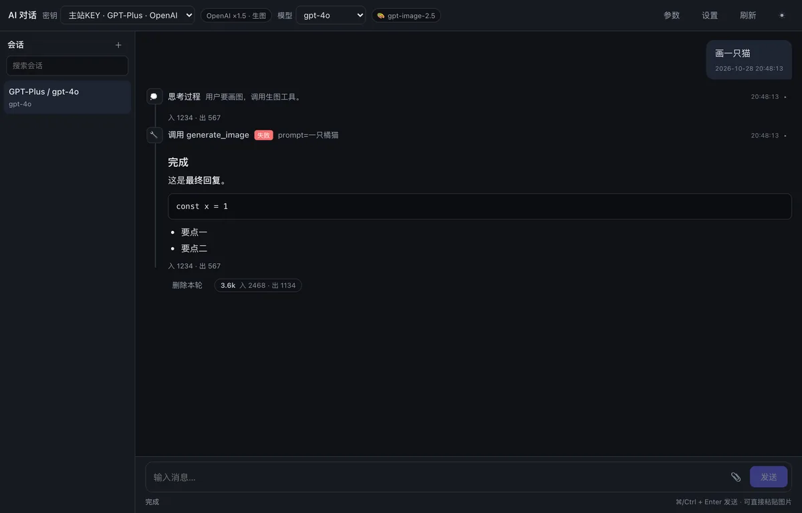
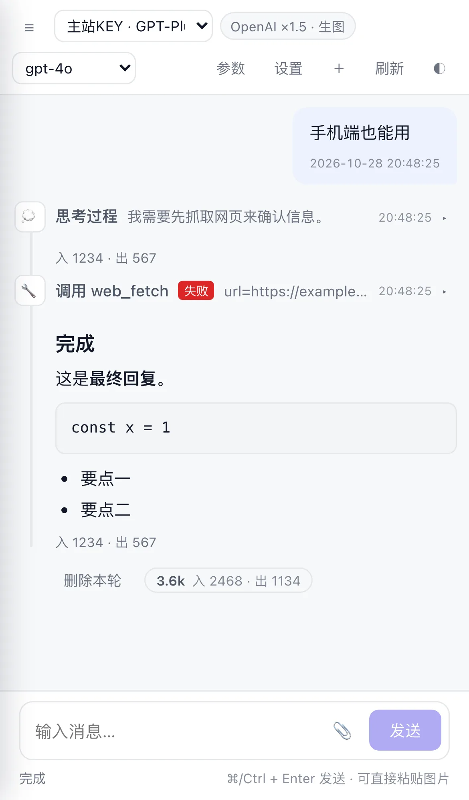
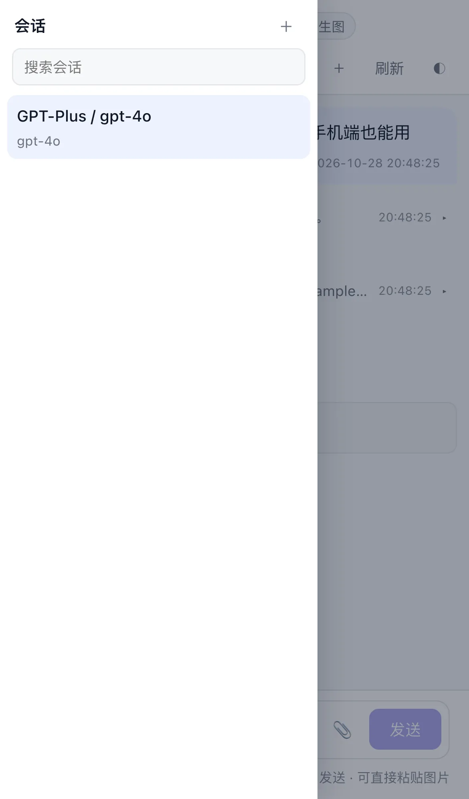
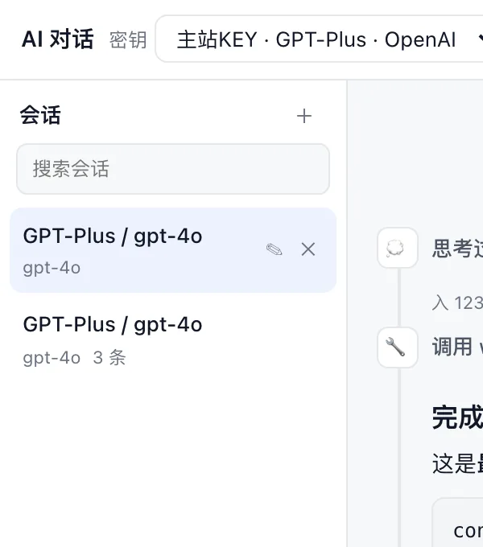

# sub2api-chat-extension

Sub2API 的独立 Web 对话前端 —— 一个可单独部署的静态站点。

**选密钥 → 自动拉模型 → 对话 / 生图 / 编图**，带推理内容展示、工具调用循环、图片句柄串联。

<p align="center">
  
</p>

## 特性

| 模块 | 说明 |
|---|---|
| **密钥即配置** | 从 sub2api 拉密钥列表，选一个就自动加载该分组的可用模型 |
| **三协议参数** | Chat Completions / Responses / Messages 各自独立的字段集，选错会 400 的地方都做了隔离 |
| **图片创作链路** | 生成 → 编辑 → 再编辑，用 `img_xxx` 句柄串联，图片不重复进上下文 |
| **工具调用循环** | `web_fetch` / 正则 / 哈希 / JWT 等纯计算工具，SSE 流式推理 + 自动重试 |
| **多模态输入** | 粘贴/拖拽图片，自动压缩到 1568px，模型能真正看到 |
| **按会话持久化** | 参数、协议、模态都存在会话快照里，刷新不丢 |
| **消息队列** | 同会话严格串行，可排队、编辑、停止 |
| **移动端适配** | 窄屏会话栏变抽屉，顶栏保留快捷入口 |

## 截图

### 主界面

思考过程、工具调用、时间戳、Token 用量都在时间线上。

<p align="center">
  
</p>

### 模型参数

左：Chat Completions 的完整字段；右：Messages 协议开启 thinking 后出现的推理强度与预算。

<table>
<tr>
<td width="50%"></td>
<td width="50%"></td>
</tr>
<tr>
<td align="center"><sub>Chat Completions：常用平铺，高级折叠</sub></td>
<td align="center"><sub>Messages：thinking 开启后联动显示</sub></td>
</tr>
</table>

### 生图与编辑

生成一张，再基于它改背景。第二张的 `parent_id` 指向第一张，形成可追溯的链路。

<p align="center">
  
</p>

### 设置

生图分组、生图模型、工具超时、全局系统提示词。

<p align="center">
  
</p>

### 深色主题

<p align="center">
  
</p>

### 移动端

<table>
<tr>
<td width="34%"></td>
<td width="34%"></td>
<td width="32%"></td>
</tr>
<tr>
<td align="center"><sub>顶栏 ☰ 与 ＋，可直接新建会话</sub></td>
<td align="center"><sub>会话栏变抽屉</sub></td>
<td align="center"><sub>重命名 / 清空 / 删除</sub></td>
</tr>
</table>

## 快速开始

```bash
npm install
npm run dev      # 本地开发
npm run build    # 产出 dist/
```

`dist/` 是纯静态文件，丢到任意静态服务器即可。但需要把 `/api` 与 `/v1` 反代到 sub2api，
否则拿不到密钥列表（同源部署可避免 CORS）。参考 `Caddyfile.example`。

## 部署

```
/chat-app/     → 本项目的 dist/
/api/*         → sub2api 后端
/v1/*          → sub2api 网关
```

浏览器需要已登录 sub2api（读取同源 Cookie / localStorage 里的 Token）。

## 与 SmartPageAgent 的关系

引擎层来自 [SmartPageAgent](https://github.com/lhstack/SmartPageAgent)，保留了**零 `chrome.*` 依赖**的核心部分。

### 完整保留（原样搬运）

| 模块 | 作用 |
|---|---|
| `runtime/tool_loop.js` | 工具循环、推理流、SSE 累加、429/5xx 退避重试、轮次上限收尾 |
| `model_provider/openai.js` | OpenAI Chat Completions 协议 |
| `model_provider/anthropic.js` | Anthropic Messages 协议 |
| `model/http.js` | SSE / JSON 双模读取 |
| `repository/*` | IndexedDB 存储：供应商、模型、会话、事件时间线 |
| `tools/registry.js` | 工具注册表与 JSON Schema 构造 |
| `tools/web.js` | `web_fetch`：HTML → Markdown 正文抽取 |

### 主要改造

| 文件 | 改动 |
|---|---|
| `runtime/prompt_builder.js` | 重写。原版围绕「操作浏览器标签页」，改为「通用对话助手 + 有限工具」 |
| `runtime/agent_executor.js` | 重写。去掉 Environment / SubAgent / Skill / MCP 解析，改为「会话 + 密钥」直连 |
| `runtime/tools/index.js` | 只注册 `web_fetch`、纯计算工具、图片工具 |
| `runtime/tools/image*.js` | **新增**：生图、编图、读图 |
| `model/model_params.js` | **新增**：三协议参数字段表（单一数据源） |
| `model/tool_result_summary.js` | **新增**：工具结果进上下文的降级逻辑 |
| `ui/*` | **全新**：Vue 3 界面 |

## 核心设计

### 图片用句柄，不传 base64

一张 1024² PNG 约 1MB，base64 后 1.4MB，折算 token 可达百万级。所以：

```
生成/编辑 → 写入 image_cache → 只把短 ID（img_xxx）交给模型
                                    ↓
                    模型要继续改 → edit_image({ image: 'img_xxx' })
                    模型要看图   → read_image({ image: 'img_xxx' })
```

实测：工具结果从 1,211,810 字符压到 **145 字符**，界面照常显示完整图片。

编辑结果记录 `parent_id` 指向源图，形成链路：

```
img_abc (generate)
   └─ img_def (edit, parent=img_abc)
        └─ img_ghi (edit, parent=img_def)
```

用户手动上传的图片同样分配句柄，可以直接 `edit_image`，不需要用户再提供链接。

### 图片何时降级

| 阶段 | 处理 |
|---|---|
| 本轮工具循环 | **完整下发**——`read_image` 的结果必须让模型真看到 |
| 组装历史（每次新发消息） | 降级为占位文本，避免上下文累积 |

`read_image` 的 base64 不放进 tool 消息（OpenAI 的 tool content 只接受文本），
而是转成一条独立的 user 消息携带 `image_url` 块。

### 工具超时

| 层级 | 位置 | 值 |
|---|---|---|
| 工具声明 | 代码里 `timeoutMs` | 生图 180s / 编图 240s |
| 会话级 | 参数面板「执行控制」 | 覆盖其他工具 |
| 全局 | 设置弹窗 | 兜底（存 config 表） |

实际取 `max(会话级或全局, 工具声明)`，所以把全局调小不会让生图必然超时。

## 目录结构

```
src/
├── engine/                     与界面无关的核心引擎
│   ├── common/                 错误、JSON、时间工具
│   ├── model/
│   │   ├── http.js             SSE / JSON 双模读取
│   │   ├── message_content.js  文本 + 图片 → parts 数组
│   │   ├── model_params.js     三协议参数字段表
│   │   └── tool_result_summary.js  工具结果降级
│   ├── model_provider/
│   │   ├── openai.js           Chat Completions / Responses
│   │   ├── anthropic.js        Messages
│   │   └── index.js            按协议分发
│   ├── repository/             IndexedDB 存取
│   │   ├── schema.js           表结构 + 默认配置
│   │   ├── session.js          会话、事件、历史组装
│   │   ├── image_cache.js      图片缓存（句柄）
│   │   ├── catalog.js          供应商、模型
│   │   ├── task.js             消息队列
│   │   └── event_vo.js         原始行 → 前端 VO
│   └── runtime/
│       ├── agent_executor.js   一轮对话的编排
│       ├── tool_loop.js        工具循环
│       ├── prompt_builder.js   系统提示词
│       └── tools/              工具实现与注册
└── ui/                         Vue 3 界面
    ├── App.vue                 顶栏、布局、会话与队列编排
    ├── engine.js               引擎对外接口
    ├── sub2api.js              调主站 API
    ├── queue.js                串行队列协调器
    ├── timeline.js             事件 → 轮次分组、usage 归一化
    └── components/
        ├── SessionRail.vue     会话列表
        ├── Composer.vue        输入区 + 队列卡片
        ├── EventTimeline.vue   消息时间线
        ├── ParamDialog.vue     模型参数弹窗
        ├── ParamField.vue      单字段控件
        ├── SafeImage.vue       按 ID 异步取图
        └── SettingsDialog.vue  设置
```

## 开发注意

| 位置 | 注意 |
|---|---|
| `tools/registry.js` | `register()` 是白名单式重建对象，**新增工具字段必须显式加进去**（`timeoutMs` 曾因此丢失） |
| `model_params.js` | `common: true` 决定进「常用」还是「高级」；`showWhen` 支持 `value` 与 `values` |
| `agent_executor.js` | 传给 `resolveModelConfig` 的是 `session.model_snapshot`，不是 `session.snapshot` |
| `session.js` 的 `buildHistoryMessages` | content 可能是 parts 数组，不能直接 `String()` |
| `tool_result_summary.js` | 判二进制要严格：长文本不是 base64，否则 `web_fetch` 正文会被误砍 |
| `engine.js` 的 `resolveToolNames` | 有副作用（注册/注销工具），调用点必须传同一个 `imageConfig` |
| `queue.js` | 入 IndexedDB 前要把 Vue 响应式对象转纯对象 |
| `queue.js` 的 `onIdle` | 解除「生成中」状态要靠这个回调，不能在 `executeTask` 里查队列——那时任务还是 `running` |
| `App.vue` 的 `onSaveParams` | `runtime` 是 emit 出的**普通对象**，写成 `runtime.value.xxx` 恒为 undefined |
| `App.vue` / `Composer.vue` | 消息区 `.wrap` 与输入区 `.composer-inner` 必须**都不设 max-width**，否则两侧边距对不齐 |

### 调试

```js
window.__s2diag()   // 密钥列表、生图配置、工具名、当前状态
```

## 已知限制

- **Gemini 通道不支持图生图**：后端 `/v1/images/edits` 只对 OpenAI / Grok 系开放
- **图片缓存不会自动过期**：删会话/清空会话会清理，长期不清理会积累
- **`web_fetch` 受 CORS 限制**：只能抓允许跨域的站点
- **会话存浏览器本地**：换设备或清缓存会丢历史

## License

MIT
